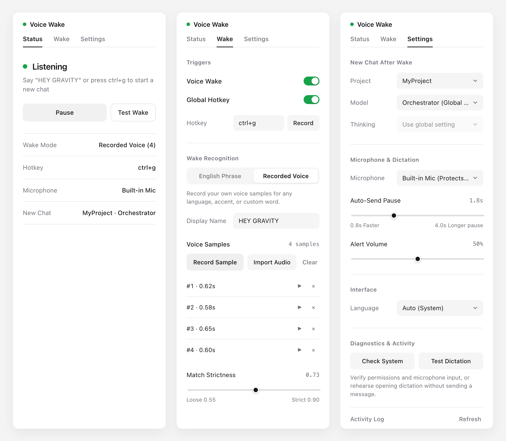

<p align="center">
  
</p>

<h1 align="center">Voice Wake for Antigravity</h1>

<p align="center">
  macOS 本地离线语音唤醒与全局快捷键插件，为 Google Antigravity 提供极简中英双语侧边栏控制面板。
</p>

<p align="center">
  <a href="./README.md">English</a> · <strong>简体中文</strong>
</p>

---

**Voice Wake**（`voice-wake`）在 macOS 本地后台持续监听。说出唤醒词或按下全局快捷键后，自动将 **Antigravity** 拉到前台、在指定项目下新建对话、切换目标模型与思考深度、启动内置语音听写，并在你说完停顿后自动结束听写并发送执行。

<p align="center">
  
</p>

## 核心特性

- **双模式 100% 本地唤醒检测**
  - **英文文本词模式**：基于 `sherpa-onnx` GigaSpeech Zipformer 流式关键词识别，支持近音备选词（`wake_aliases`）、三档灵敏度预设（`高灵敏` / `平衡` / `严格`）与 Silero VAD 语音分段过滤。
  - **录制声音模式**：基于 `EfficientWord-Net`（`Resnet50_Arc_loss` 量化 INT8 ONNX）进行本地少样本声纹/短语匹配——支持在面板直接录制本人发音或导入 `.wav` / `.m4a` / `.mp3` 音频，适配中文、方言或任意自造口令。
- **全局快捷键并存**：原生 macOS Carbon 全局快捷键（默认 `ctrl+g`，支持在面板内按键录制），无需“输入监控”权限；即使暂时关闭语音监听，按快捷键仍可随时唤起听写。
- **保护蓝牙耳机音质**：默认使用内置麦克风（`mic_mode: "built-in"`）监听，避免蓝牙耳机被迫切换到低音质 HFP 通话模式。
- **说完停顿自动发送**：结合本地 Silero VAD 与输入框文本变化双信号判断停顿（默认 `1.8s`），自动停止听写并发送消息，随后恢复待命。
- **极简双语三标签控制面板（`状态` / `唤醒` / `设置`）**：
  - 默认自动识别 macOS 系统语言（简体中文环境显示中文，英文及其他非中英文环境默认显示英文），并可在 **设置 → 界面 → 语言** 手动切换。
  - **状态**页保持纯净专注：常驻状态说明、`暂停监听 / 开始监听`、`测试唤醒` 与当前生效配置摘要；所有设置与滑块改动实时自动保存并热生效。
  - **设置**页内置 **排查与记录**：一键执行环境检查、测试唤起（不发送）以及中文可读的运行记录。

## 系统要求

- macOS（推荐 Apple Silicon）+ **Antigravity App**
- Xcode Command Line Tools（提供 `swiftc`）
- `uv` 或 Python `3.11–3.13`
- **系统权限**（首次使用时按系统提示授予）：
  - **麦克风**：用于本地唤醒检测与听写
  - **辅助功能（Accessibility）**：用于激活 Antigravity 窗口、新建对话与触发听写

## 一键安装

```bash
git clone https://github.com/rmqg/antigravity-voice-wake.git
cd antigravity-voice-wake
chmod +x install.sh uninstall.sh
./install.sh
```

`install.sh` 会自动完成以下准备：
1. 在 `~/.local/share/venvs/antigravity-voice-wake` 创建独立 Python 3.12 环境，安装 `sherpa-onnx`、`sounddevice`、`numpy`、`onnxruntime`、`EfficientWord-Net`；
2. 下载本地 ONNX 唤醒与 Silero VAD 模型到 `~/.local/share/antigravity-voice-wake/models/`；
3. 编译 [agy_ax_helper.swift](./swift/agy_ax_helper.swift) 到 `~/.local/share/antigravity-voice-wake/bin/agy-ax-helper`；
4. 按 [config.example.json](./sidecars/voice-wake/config.example.json) 初始化 `~/.local/share/antigravity-voice-wake/config.json`；
5. 将插件链接到 `~/.gemini/config/plugins/voice-wake` 并启用 Sidecar 控制面板。

安装完成后，在 Antigravity 右侧栏打开 **Voice Wake** 面板（或在对话中使用 `/voice-wake` 技能）即可开始使用。

## 面板功能说明

- **状态**：查看当前监听状态、一键暂停/恢复语音监听、开启 **测试唤醒**（只响铃计数与查看匹配度，不会新建对话），以及查看生效中的唤醒方式、快捷键、麦克风和目标会话。
- **唤醒**：开关语音唤醒与全局快捷键、录制自定义快捷键、切换「英文文本词」或「录制的声音」、录制/导入/试听/删除个人语音样本、调节灵敏度与高级阈值。
- **设置**：配置唤醒后新建对话的目标项目、默认模型与思考深度；选择输入麦克风、说完自动发送停顿秒数、提示音量及界面语言（`跟随系统` / `English` / `简体中文`）；底部可进行 **环境检查**、**测试唤起（不发送）** 与查看 **运行记录**。

## 常用命令行诊断

```bash
# 检查辅助功能权限、麦克风收音电平以及本地语音模型状态
~/.gemini/config/plugins/voice-wake/sidecars/voice-wake/run.sh --check

# 使用 16kHz 单声道 WAV 测试唤醒词识别
~/.gemini/config/plugins/voice-wake/sidecars/voice-wake/run.sh --test-wav /path/to/test.wav

# 执行一次完整唤起演练（仅唤起听写，不会自动发送消息）
~/.gemini/config/plugins/voice-wake/sidecars/voice-wake/run.sh --trigger-now --dry-run-submit
```

## 卸载

```bash
./uninstall.sh
```

## 目录结构

```text
antigravity-voice-wake/
├── assets/logo.svg                 # 扁平化矢量插件图标
├── plugin.json                     # Antigravity 插件清单
├── install.sh / uninstall.sh       # macOS 安装与卸载脚本
├── swift/agy_ax_helper.swift       # 原生 macOS 辅助功能与 Carbon 快捷键助手
├── skills/voice-wake/SKILL.md      # 配套 Agent 技能说明
├── sidecars/voice-wake/
│   ├── sidecar.json                # 侧边栏 Sidecar 清单
│   ├── config.example.json         # 默认配置模板
│   ├── voice_wake.py               # 音频管线、本地检测守护进程与 HTTP API
│   ├── index.html                  # 中英双语三标签侧边栏控制面板
│   └── run.sh                      # 虚拟环境启动脚本
├── THIRD_PARTY_NOTICES.md          # 第三方开源组件与模型致谢
└── LICENSE                         # Apache-2.0 开源协议
```

## 开源致谢与协议

上游开源项目与预训练模型署名见 [THIRD_PARTY_NOTICES.md](./THIRD_PARTY_NOTICES.md)（`sherpa-onnx`、`silero-vad`、`wake-for-codex`、`EfficientWord-Net`）。

本项目基于 [Apache License 2.0](./LICENSE) 开源。
